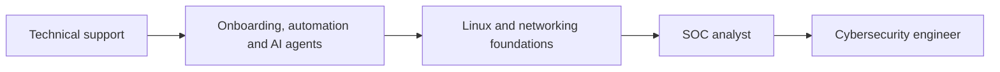

<div align="center">

# Lucas Cardoso

**Customer Onboarding & Technical Support · Automation & AI Agents**
*Building my way into cybersecurity.*

[](https://www.linkedin.com/in/lucascardoso-it/)


</div>

---

```bash
lucas@lab:~$ whoami
lucas — onboarding & technical support analyst at a lead-management SaaS

lucas@lab:~$ cat now.txt
> shipping customer implementations, trainings and troubleshooting
> building automations and AI agent workflows (n8n, Make, Python, REST APIs)
> studying Linux and networking in a home lab (Kali + Debian VMs)
> next stop: SOC analyst role, Security+

lucas@lab:~$ echo $MOTTO
"Certificates show what I studied. Repositories show what I can do."
```

## What I do

- **Customer onboarding.** Training sessions and full implementation for new customers, plus technical troubleshooting so activation never gets blocked.
- **Automation and AI agents.** Workflows built with n8n, Make, Python and REST APIs to remove manual work from onboarding and internal processes.
- **Technical enablement.** Created a video-based API guide that became a training reference for the team.

## Tech stack


## Where I'm heading



## Featured projects

| Project | What it is |
|---|---|
| [support-api-academy](https://github.com/lucascardoso1912/support-api-academy) | Practical, video-based API documentation that support and onboarding teams use for training. |
| [security-journey](https://github.com/lucascardoso1912/security-journey) | Study notes, lab write-ups and hands-on exercises on my path to security. |

<details>
<summary><b>Current learning plan</b> (click to expand)</summary>

<br>

| Phase | Topics |
|---|---|
| Linux | Filesystem, paths, permissions, processes, services, shell, text tools, logs |
| Networking | TCP/IP, subnets, ports, TCP handshake, DNS, DHCP, HTTP/TLS, NAT, troubleshooting |
| Integration | Small lab project combining both, fully documented |
| Next | Security+, SIEM, SOC workflows |

I work in a home lab and write down what I learn, including my mistakes.

</details>

---

<div align="center">

*Open to conversations about security, automation and AI agents.*

</div>
